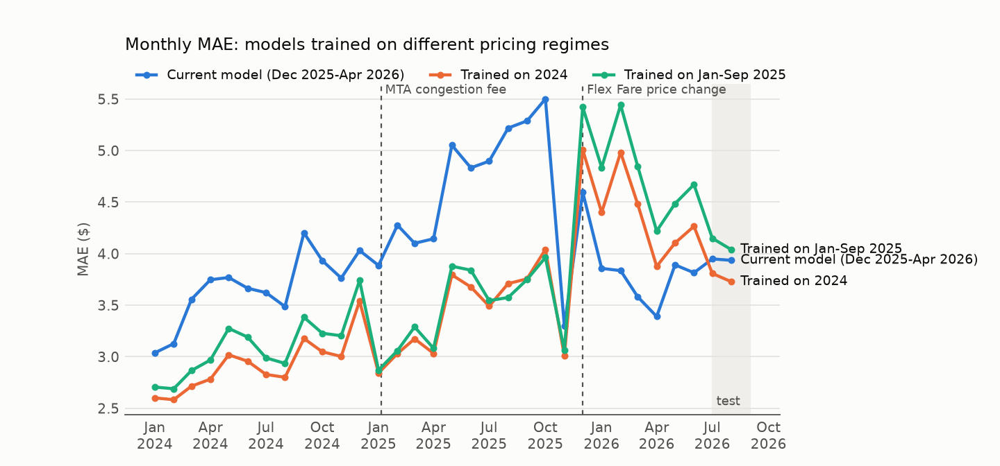
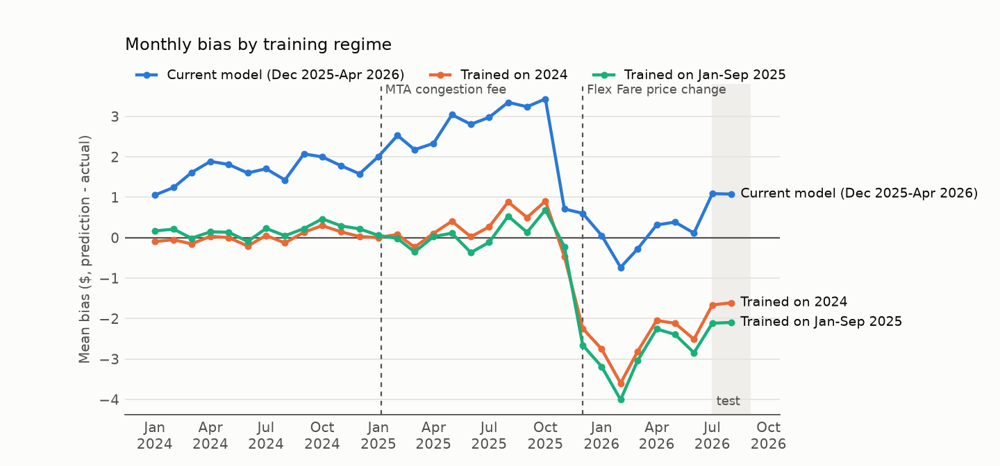
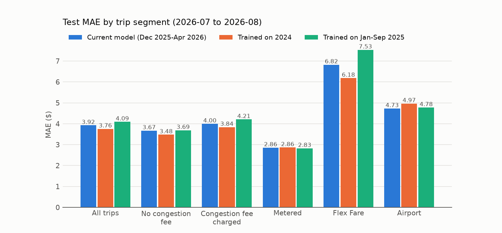

# Taxiflow: NYC Taxi Fare Prediction Under Pricing Drift

Taxiflow predicts the **upfront fare** of an NYC yellow taxi trip (everything the rider is charged except the tip) from information available at booking time, and returns a **split-conformal prediction interval** around it. It is trained and evaluated on **119.6 million TLC trip records (Jan 2024 – Aug 2026)** with a strict out-of-time split, and served through a FastAPI endpoint.

```
TLC parquet (32 months, 119.6M trips)
  └─ DuckDB cleaning ──► 107.3M trips ──► pre-trip features ──► LightGBM on seasonally adjusted fares
       (filters, known-bad       (zone centroids, congestion-zone flags,          │
        vendor records)           historical route stats, time, booking type)     ▼
                                     × seasonal index − last month's bias ──► conformal interval
                                                    POST /v1/predict-fare ──► $fare [lower, upper]
```

## What the data showed

The 32-month window contains three pricing regimes, and finding them shaped the whole design:

1. **MTA congestion pricing (5 Jan 2025).** Trips into or within Manhattan below 60th St carry an extra $0.75 `cbd_congestion_fee`. Rather than hard-coding the zone boundary, Taxiflow derives it from the data: 38 zones have the fee on ≥ 96.9% of 2025–26 pickups, the next-highest zone is at 61.3%, and all 38 are in Manhattan below 60th St.
2. **A data-quality bug in Flex Fare records.** TLC "Flex Fare" (app-booked, upfront-priced, `payment_type = 0`) trips grew from about 5% of trips in January 2024 to 21–30% of monthly trips in 2026. For one vendor (`VendorID = 2`), the Flex Fare `fare_amount` for 2–3 mile trips falls to a placeholder median of **$2.59 in November 2025**, while the other vendor's median for the same trips is about $17. Those 872K records are excluded through a declarative rule in [`configs/default.yaml`](configs/default.yaml).
3. **A Flex Fare price step on 1 Dec 2025.** For 2–3 mile Flex Fare trips, vendor 1's median charge rises from $21.40 (Nov 2025) to $24.68 (Dec 2025), and vendor 2's from $19.91 (Sep 2025, the last month before its records degrade) to $27.31. Metered fares stay flat across all 32 months.

The model is therefore trained **only on the current regime (Dec 2025 onward)**. The **drift study** retrains the same pipeline on earlier regimes and scores every model on the same test months, to measure what stale training data costs.

## Results

<!-- RESULTS:START -->
Out-of-time test set: **all 6,219,515 cleaned trips from 2026-07 to 2026-08**. Target is the total charge excluding tip. Data: 119,595,677 raw trips (2024-01 to 2026-08), 107,308,530 after cleaning.

| Model | RMSE ($) | MAE ($) | Median AE ($) | Bias ($) |
|---|---|---|---|---|
| **LightGBM, current regime** (Dec 2025-Apr 2026) | 6.17 | 3.92 | 2.54 | +1.07 |
| ElasticNet (same features) | 6.93 | 4.57 | 3.14 | +1.35 |
| Historical zone-pair median | 7.21 | 4.27 | 2.80 | -0.27 |
| LightGBM trained Jan-Sep 2025 | 6.99 | 4.09 | 2.37 | -2.12 |
| LightGBM trained 2024 | 6.33 | 3.76 | 2.31 | -1.65 |

**90% conformal intervals** (calibrated on 2026-06):

| Interval | Coverage (all) | Mean width | Coverage, Flex Fare | Coverage, airport |
|---|---|---|---|---|
| Fixed width (± q) | 88.8% | $16.75 | 69.9% | 85.6% |
| Adaptive (± q x predicted error) | 91.4% | $15.81 | 91.3% | 90.4% |

**Inference latency** (one request: feature build + prediction + interval, single thread, 1,950 requests): p50 0.40 ms, p95 0.89 ms, p99 1.15 ms.

**Drift study, MAE ($) on the same test trips:**

| Segment | Share | Current model (Dec 2025-Apr 2026) | Trained on 2024 | Trained on Jan-Sep 2025 |
|---|---|---|---|---|
| All trips | 100% | 3.92 | 3.76 | 4.09 |
| No congestion fee | 22% | 3.67 | 3.48 | 3.69 |
| Congestion fee charged | 78% | 4.00 | 3.84 | 4.21 |
| Metered | 73% | 2.86 | 2.86 | 2.83 |
| Flex Fare | 27% | 6.82 | 6.18 | 7.53 |
| Airport | 9% | 4.73 | 4.97 | 4.78 |

**Model maintenance, walk-forward over 2026-07 to 2026-08** (assumes last month's trips are available at the start of each month):

| Strategy | MAE ($) | RMSE ($) | Bias ($) | Flex Fare MAE | Metered MAE | MAE 2026-07 | MAE 2026-08 | Coverage |
|---|---|---|---|---|---|---|---|---|
| Static (current-regime model, unchanged) | 3.92 | 6.17 | +1.07 | 6.82 | 2.86 | 3.93 | 3.92 | 91.4% |
| **Monthly bias correction** (served by the API) | 3.72 | 5.92 | +0.49 | 5.99 | 2.88 | 3.81 | 3.61 | 91.0% |
| Monthly retrain (previous 4 months) | 3.87 | 6.08 | +1.07 | 6.61 | 2.86 | 3.92 | 3.82 | 90.6% |
<!-- RESULTS:END -->

**Reading the results:**

- **The drift study is the headline.** From December 2025, the models trained on earlier regimes underprice by $1.61–3.60 (2024 model) and $2.10–4.01 (Jan–Sep 2025 model) per trip, month after month (bias chart). The current-regime model stays within ±$0.75 through June 2026.
- **Training on the newest regime is not enough on its own.** Flex Fare prices fell again in Jul–Aug 2026, so the current-regime model overprices Flex Fare trips (+$3.88) while the 2024 model underprices them (−$3.96). Unchanged, the current-regime model has a higher MAE than the 2024 model ($3.92 vs $3.76) but a lower RMSE ($6.17 vs $6.33).
- **Metered trips (73% of trips) are stable.** All three models score MAE $2.83–2.86 on them, and the seasonal index brings the current-regime model's metered bias to +$0.04.
- **A monthly bias correction is the best strategy measured.** Subtracting last month's mean error per booking type cuts MAE by 5.3% (to $3.72), and by 7.9% in August, beating every other model, including the 2024 one. Retraining on the previous four months helps less (−1.4%). The API serves the corrected model.
- **Adaptive intervals keep their coverage where fixed ones fail.** Fixed-width intervals cover only 69.9% of Flex Fare trips. Adaptive intervals cover at least 90.4% in every segment, with a narrower mean width.





## Design

**Split (out-of-time, by month).** Train Dec 2025 – Apr 2026 (1M trips sampled per month) · validation May 2026 (early stopping + interval-width model) · calibration Jun 2026 (conformal only) · **test Jul – Aug 2026, every trip**. Drift models: trained on Jan – Nov 2024, and on Jan – Sep 2025.

**Features (all known before the trip).** Pickup and dropoff zone (LightGBM categoricals), borough, hour, day of week, cyclical time encodings, the TLC rush-hour and overnight surcharge windows, centroid haversine and Manhattan distances and bearing, airport and congestion-zone flags, booking type (street hail or Flex Fare), and **historical route statistics**: the median distance, median duration and trip count per zone pair, computed from the training window only. Realised trip distance and duration are never inputs ([`tests/test_features.py`](tests/test_features.py) enforces this).

**Seasonality** ([`src/taxiflow/features/seasonality.py`](src/taxiflow/features/seasonality.py)). The training window is shorter than a year, so calendar month cannot be learned as a feature. Instead, a seasonal price index is estimated from metered trips in Jan 2024 – Nov 2025: each fare is divided by the median fare of its zone pair in that year, so changes in trip mix cancel out, and the monthly means are averaged across years. The index ranges from 0.968 (January) to 1.043 (December), and 2024 and 2025 agree within 1% for every month. The model is trained on fare ÷ index and multiplies its prediction back.

**Monthly correction** (`taxiflow correct --month YYYY-MM`). The most recent month is split in half at random: one half gives the mean error separately for metered and Flex Fare trips, which is then subtracted from predictions; the other half recalibrates the conformal intervals on the corrected predictions. The served model is corrected with August 2026 (metered +$0.02, Flex Fare +$3.94).

**Zone geometry.** Centroids of all 263 TLC zone polygons, computed from the official shapefile in NY State Plane coordinates, converted to WGS84, and shipped inside the package ([`scripts/build_zone_table.py`](scripts/build_zone_table.py)).

**Uncertainty.** Split conformal prediction with the finite-sample quantile correction. Besides the fixed-width interval (± q), an adaptive variant scales the interval by a second LightGBM model of the expected absolute error, giving narrow intervals for short Manhattan hops and wide ones for airport runs. The API serves the adaptive interval.

**Cleaning** ([`src/taxiflow/data/clean.py`](src/taxiflow/data/clean.py)). The following trips are dropped: pickups outside the file's month; unknown zones (264/265); voided, disputed and no-charge payments; negotiated and group rate codes; fares outside $3–$500; implausible distance, duration or speed; and the known-bad vendor records. Each month is cleaned with DuckDB straight from parquet, so memory stays flat.

## Quick start

```bash
uv sync --python 3.11            # runtime + dev dependencies
uv run pytest                    # 32 tests, no data needed

# Full pipeline (~1.9 GB download, ~12 GB RAM):
bash scripts/reproduce.sh

# Serve
uv run taxiflow serve --port 8000   # demo page: http://localhost:8000/   API docs: /docs
curl -X POST http://localhost:8000/v1/predict-fare \
  -H "Content-Type: application/json" \
  -d '{"pulocation_id": 132, "dolocation_id": 230, "pickup_datetime": "2026-10-15T18:30:00", "booking_type": "street_hail"}'

# Docker (after training)
docker build -t taxiflow .
docker run -p 8000:8000 taxiflow
```

## Project structure

```
Taxiflow-NYC-Taxi-Fare-Prediction-Under-Pricing-Drift/
├── .github/
│   └── workflows/
│       └── ci.yml                  # CI: locked install, ruff lint, pytest on every push / PR
├── configs/
│   └── default.yaml                # Data window, cleaning filters, known-bad records, train/val/cal/test
│                                   #   months, drift models, seasonality, walk-forward, LightGBM params, serving
├── docs/
│   └── figures/                    # Generated by scripts/make_report.py
│       ├── drift_timeline_mae.png  #   monthly MAE of each model, Jan 2024 - Aug 2026
│       ├── drift_timeline_bias.png #   monthly bias of each model
│       └── drift_mae_by_segment.png#   test MAE by trip segment
├── reports/                        # Generated; every number in this README comes from here
│   ├── metrics.json                #   test metrics, segments, intervals, latency, drift timeline, seasonal index
│   └── walkforward.json            #   static vs monthly correction vs monthly retrain
├── scripts/
│   ├── reproduce.sh                # Full pipeline: download → clean → zone table → train → evaluate
│   │                               #   → walk-forward → correct → report → tests
│   ├── build_zone_table.py         # Zone centroids from the TLC shapefile + data-derived congestion zone
│   └── make_report.py              # Figures and the README results tables from reports/*.json
├── src/
│   └── taxiflow/
│       ├── __init__.py             # Package version
│       ├── cli.py                  # `taxiflow` CLI: download, clean, train, evaluate, walkforward, correct, serve, info
│       ├── config.py               # Pydantic config models loaded from configs/default.yaml
│       ├── pipeline.py             # Training and evaluation orchestration
│       ├── data/
│       │   ├── download.py         # Monthly TLC parquet download (resumable, size-checked)
│       │   └── clean.py            # DuckDB cleaning per month + cleaning report
│       ├── features/
│       │   ├── geospatial.py       # Zone table loader, haversine / Manhattan distance, bearing, time encodings
│       │   ├── build.py            # Booking-time feature matrix shared by training and serving; route statistics
│       │   └── seasonality.py      # Route-controlled seasonal price index from metered trips
│       ├── models/
│       │   ├── train.py            # FareModel (LightGBM + seasonal index + monthly correction), training, baselines
│       │   └── conformal.py        # Split conformal intervals, fixed and adaptive
│       ├── evaluation/
│       │   ├── metrics.py          # RMSE, MAE, median AE, bias
│       │   └── walkforward.py      # Month-by-month comparison of maintenance strategies
│       ├── serving/
│       │   ├── api.py              # FastAPI: /v1/predict-fare, /v1/zones, /health, demo page at /
│       │   └── demo.html           # Interactive demo page
│       └── resources/
│           └── zone_table.csv      # 263 TLC zones: borough, name, centroid, area, congestion-zone flag
├── tests/                          # 34 tests on synthetic data (no download needed)
│   ├── conftest.py                 # Small synthetic FareModel fixture
│   ├── test_api.py                 # Endpoints, validation, timezone handling, demo page
│   ├── test_conformal.py           # Interval coverage and bounds
│   ├── test_data.py                # Cleaning filters, known-bad records, schema differences
│   ├── test_features.py            # Feature values, route statistics, no post-trip inputs
│   ├── test_geospatial.py          # Distances, airports, time encoding
│   └── test_model.py               # Seasonal index fit, monthly correction
├── .dockerignore
├── .gitattributes
├── .gitignore
├── .python-version                 # Python 3.11
├── Dockerfile                      # Two-stage image serving the trained model
├── PROJECT_EXPLANATION.md          # Design rationale, pipeline, pricing changes, uncertainty, serving
├── README.md
├── pyproject.toml                  # Dependencies (+ dev / geo / viz groups), `taxiflow` entry point, ruff, pytest
└── uv.lock                         # Locked dependency versions
```

Created locally by the pipeline and not committed (see `.gitignore`):

```
data/raw/          # Monthly TLC parquet files (~1.9 GB)
data/processed/    # Cleaned monthly parquet + cleaning_report.json (~1 GB)
models/            # Trained models: taxiflow_lgbm.joblib (base), taxiflow_lgbm_serving.joblib (served),
                   #   two drift-study models, baselines.joblib
```

## Limitations

- Fares depend on traffic, and on the route the driver actually takes, neither of which is known at booking, so a large part of the error cannot be removed with pre-trip features.
- Flex Fare prices are set by the booking apps and can change without notice (as on 1 Dec 2025 and again in July 2026). The monthly correction follows such changes one month late.
- The walk-forward results assume last month's trips are available at the start of each month, which holds for an operator's own records. The public TLC release lags by about two months.
- The seasonal index is estimated from metered trips; Flex Fare pricing has no stable seasonal pattern in this data.
- Weather, events and live traffic are not used.
- Yellow taxis only.
